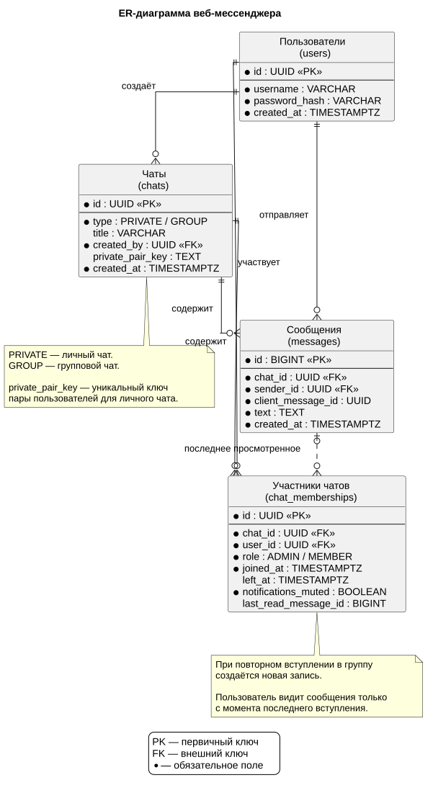

# Web Messenger

Веб-мессенджер с личными и групповыми чатами, разрабатываемый в рамках проекта VK Education.

## Возможности

- Регистрация и авторизация пользователей.
- Личные и групповые чаты.
- Обмен сообщениями в реальном времени через WebSocket.
- Хранение истории сообщений и поиск по переписке.
- Управление участниками групп.
- Уведомления о новых сообщениях.

## Документация

- [Исходный текст задания VK Education](docs/TASK.md)
- [Спецификация требований к ПО](docs/SRS.md)

## ER-диаграмма

## Статус проекта

Проект находится на этапе проектирования.
