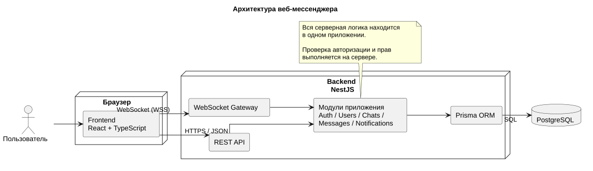

# Архитектура веб-мессенджера

## 1. Общая архитектура

Для проекта выбрана клиент-серверная архитектура с модульным монолитом на backend.

Система состоит из трёх основных компонентов:

- **Frontend** — интерфейс пользователя на React и TypeScript.
- **Backend** — серверное приложение на NestJS.
- **База данных** — PostgreSQL для хранения пользователей, чатов и сообщений.

## 2. Взаимодействие компонентов

Frontend взаимодействует с backend двумя способами:

- **REST API** — авторизация, создание чатов, управление участниками, загрузка истории и поиск.
- **WebSocket** — отправка и получение сообщений, подтверждение доставки и уведомления.

Backend проверяет авторизацию и права пользователей, обрабатывает запросы и работает с базой данных через Prisma.

## 3. Модули backend

- `AuthModule` — регистрация и авторизация.
- `UsersModule` — работа с пользователями.
- `ChatsModule` — управление чатами и участниками.
- `MessagesModule` — работа с сообщениями.
- `NotificationsModule` — уведомления и их настройки.
- `PrismaModule` — взаимодействие с базой данных.

## 4. Используемые технологии

| Компонент         | Технология         |
| ----------------- | ------------------ |
| Frontend          | React, TypeScript  |
| Backend           | NestJS, TypeScript |
| База данных       | PostgreSQL         |
| ORM               | Prisma             |
| Авторизация       | JWT                |
| Обмен сообщениями | WebSocket          |
| Развёртывание     | Docker Compose     |

## 5. Особенности архитектуры

- Backend состоит из нескольких модулей, работающих в одном приложении.
- Сообщения сохраняются в БД до отправки подтверждения клиенту.
- Все проверки прав доступа выполняются на сервере.
- Если пользователь не в сети, сообщения остаются в БД и доступны после подключения.
- Для MVP не используются отдельные микросервисы и брокеры сообщений.
